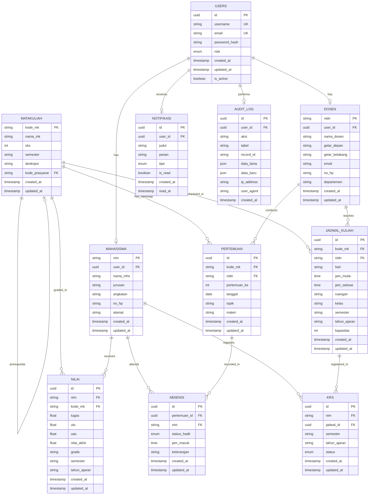

# Database Schema Design - Academic Information System

## Entity Relationship Diagram (ERD)



## Table Structures

### 1. Users Table
```sql
CREATE TABLE users (
    id UUID PRIMARY KEY DEFAULT gen_random_uuid(),
    username VARCHAR(50) UNIQUE NOT NULL,
    email VARCHAR(100) UNIQUE NOT NULL,
    password_hash VARCHAR(255) NOT NULL,
    role VARCHAR(20) CHECK (role IN ('admin', 'dosen', 'mahasiswa')) NOT NULL,
    created_at TIMESTAMP DEFAULT CURRENT_TIMESTAMP,
    updated_at TIMESTAMP DEFAULT CURRENT_TIMESTAMP,
    is_active BOOLEAN DEFAULT true
);
```

### 2. Mahasiswa Table
```sql
CREATE TABLE mahasiswa (
    nim VARCHAR(20) PRIMARY KEY,
    user_id UUID REFERENCES users(id) ON DELETE CASCADE,
    nama_mhs VARCHAR(100) NOT NULL,
    jurusan VARCHAR(50) NOT NULL,
    angkatan VARCHAR(10) NOT NULL,
    no_hp VARCHAR(15),
    alamat TEXT,
    created_at TIMESTAMP DEFAULT CURRENT_TIMESTAMP,
    updated_at TIMESTAMP DEFAULT CURRENT_TIMESTAMP
);
```

### 3. Dosen Table
```sql
CREATE TABLE dosen (
    nidn VARCHAR(20) PRIMARY KEY,
    user_id UUID REFERENCES users(id) ON DELETE CASCADE,
    nama_dosen VARCHAR(100) NOT NULL,
    gelar_depan VARCHAR(20),
    gelar_belakang VARCHAR(50),
    email VARCHAR(100),
    no_hp VARCHAR(15),
    departemen VARCHAR(50),
    created_at TIMESTAMP DEFAULT CURRENT_TIMESTAMP,
    updated_at TIMESTAMP DEFAULT CURRENT_TIMESTAMP
);
```

### 4. Mata Kuliah Table
```sql
CREATE TABLE matakuliah (
    kode_mk VARCHAR(10) PRIMARY KEY,
    nama_mk VARCHAR(100) NOT NULL,
    sks INTEGER NOT NULL CHECK (sks > 0),
    semester VARCHAR(20) NOT NULL,
    deskripsi TEXT,
    kode_prasyarat VARCHAR(10) REFERENCES matakuliah(kode_mk),
    created_at TIMESTAMP DEFAULT CURRENT_TIMESTAMP,
    updated_at TIMESTAMP DEFAULT CURRENT_TIMESTAMP
);
```

### 5. Jadwal Kuliah Table
```sql
CREATE TABLE jadwal_kuliah (
    id UUID PRIMARY KEY DEFAULT gen_random_uuid(),
    kode_mk VARCHAR(10) REFERENCES matakuliah(kode_mk) ON DELETE CASCADE,
    nidn VARCHAR(20) REFERENCES dosen(nidn) ON DELETE CASCADE,
    hari VARCHAR(10) CHECK (hari IN ('Senin', 'Selasa', 'Rabu', 'Kamis', 'Jumat', 'Sabtu', 'Minggu')),
    jam_mulai TIME NOT NULL,
    jam_selesai TIME NOT NULL,
    ruangan VARCHAR(20) NOT NULL,
    kelas VARCHAR(20),
    semester VARCHAR(20) NOT NULL,
    tahun_ajaran VARCHAR(10) NOT NULL,
    kapasitas INTEGER DEFAULT 40,
    created_at TIMESTAMP DEFAULT CURRENT_TIMESTAMP,
    updated_at TIMESTAMP DEFAULT CURRENT_TIMESTAMP,
    CONSTRAINT jam_check CHECK (jam_selesai > jam_mulai)
);
```

### 6. KRS Table
```sql
CREATE TABLE krs (
    id UUID PRIMARY KEY DEFAULT gen_random_uuid(),
    nim VARCHAR(20) REFERENCES mahasiswa(nim) ON DELETE CASCADE,
    jadwal_id UUID REFERENCES jadwal_kuliah(id) ON DELETE CASCADE,
    semester VARCHAR(20) NOT NULL,
    tahun_ajaran VARCHAR(10) NOT NULL,
    status VARCHAR(20) DEFAULT 'aktif' CHECK (status IN ('aktif', 'batal', 'selesai')),
    created_at TIMESTAMP DEFAULT CURRENT_TIMESTAMP,
    updated_at TIMESTAMP DEFAULT CURRENT_TIMESTAMP,
    UNIQUE(nim, jadwal_id, semester, tahun_ajaran)
);
```

### 7. Nilai Table
```sql
CREATE TABLE nilai (
    id UUID PRIMARY KEY DEFAULT gen_random_uuid(),
    nim VARCHAR(20) REFERENCES mahasiswa(nim) ON DELETE CASCADE,
    kode_mk VARCHAR(10) REFERENCES matakuliah(kode_mk) ON DELETE CASCADE,
    tugas DECIMAL(5,2) CHECK (tugas >= 0 AND tugas <= 100),
    uts DECIMAL(5,2) CHECK (uts >= 0 AND uts <= 100),
    uas DECIMAL(5,2) CHECK (uas >= 0 AND uas <= 100),
    nilai_akhir DECIMAL(5,2) CHECK (nilai_akhir >= 0 AND nilai_akhir <= 100),
    grade VARCHAR(2) CHECK (grade IN ('A', 'B+', 'B', 'C+', 'C', 'D', 'E')),
    semester VARCHAR(20) NOT NULL,
    tahun_ajaran VARCHAR(10) NOT NULL,
    created_at TIMESTAMP DEFAULT CURRENT_TIMESTAMP,
    updated_at TIMESTAMP DEFAULT CURRENT_TIMESTAMP,
    UNIQUE(nim, kode_mk, semester, tahun_ajaran)
);
```

### 8. Pertemuan Table
```sql
CREATE TABLE pertemuan (
    id UUID PRIMARY KEY DEFAULT gen_random_uuid(),
    kode_mk VARCHAR(10) REFERENCES matakuliah(kode_mk) ON DELETE CASCADE,
    nidn VARCHAR(20) REFERENCES dosen(nidn) ON DELETE CASCADE,
    pertemuan_ke INTEGER NOT NULL,
    tanggal DATE NOT NULL,
    topik VARCHAR(200),
    materi TEXT,
    created_at TIMESTAMP DEFAULT CURRENT_TIMESTAMP,
    updated_at TIMESTAMP DEFAULT CURRENT_TIMESTAMP
);
```

### 9. Absensi Table
```sql
CREATE TABLE absensi (
    id UUID PRIMARY KEY DEFAULT gen_random_uuid(),
    pertemuan_id UUID REFERENCES pertemuan(id) ON DELETE CASCADE,
    nim VARCHAR(20) REFERENCES mahasiswa(nim) ON DELETE CASCADE,
    status_hadir VARCHAR(20) CHECK (status_hadir IN ('hadir', 'izin', 'sakit', 'alpa')),
    jam_masuk TIME,
    keterangan TEXT,
    created_at TIMESTAMP DEFAULT CURRENT_TIMESTAMP,
    updated_at TIMESTAMP DEFAULT CURRENT_TIMESTAMP,
    UNIQUE(pertemuan_id, nim)
);
```

### 10. Notifikasi Table
```sql
CREATE TABLE notifikasi (
    id UUID PRIMARY KEY DEFAULT gen_random_uuid(),
    user_id UUID REFERENCES users(id) ON DELETE CASCADE,
    judul VARCHAR(200) NOT NULL,
    pesan TEXT NOT NULL,
    tipe VARCHAR(20) CHECK (tipe IN ('info', 'warning', 'success', 'error')),
    is_read BOOLEAN DEFAULT false,
    created_at TIMESTAMP DEFAULT CURRENT_TIMESTAMP,
    read_at TIMESTAMP
);
```

### 11. Audit Log Table
```sql
CREATE TABLE audit_log (
    id UUID PRIMARY KEY DEFAULT gen_random_uuid(),
    user_id UUID REFERENCES users(id) ON DELETE SET NULL,
    aksi VARCHAR(50) NOT NULL,
    tabel VARCHAR(50) NOT NULL,
    record_id VARCHAR(50),
    data_lama JSONB,
    data_baru JSONB,
    ip_address INET,
    user_agent TEXT,
    created_at TIMESTAMP DEFAULT CURRENT_TIMESTAMP
);
```

## Indexes for Performance

```sql
-- Indexes for better query performance
CREATE INDEX idx_mahasiswa_nim ON mahasiswa(nim);
CREATE INDEX idx_mahasiswa_user_id ON mahasiswa(user_id);
CREATE INDEX idx_dosen_nidn ON dosen(nidn);
CREATE INDEX idx_dosen_user_id ON dosen(user_id);
CREATE INDEX idx_matakuliah_kode_mk ON matakuliah(kode_mk);
CREATE INDEX idx_jadwal_kuliah_kode_mk ON jadwal_kuliah(kode_mk);
CREATE INDEX idx_jadwal_kuliah_nidn ON jadwal_kuliah(nidn);
CREATE INDEX idx_jadwal_kuliah_semester_tahun ON jadwal_kuliah(semester, tahun_ajaran);
CREATE INDEX idx_krs_nim ON krs(nim);
CREATE INDEX idx_krs_jadwal_id ON krs(jadwal_id);
CREATE INDEX idx_nilai_nim ON nilai(nim);
CREATE INDEX idx_nilai_kode_mk ON nilai(kode_mk);
CREATE INDEX idx_absensi_pertemuan_id ON absensi(pertemuan_id);
CREATE INDEX idx_absensi_nim ON absensi(nim);
CREATE INDEX idx_notifikasi_user_id ON notifikasi(user_id);
CREATE INDEX idx_audit_log_user_id ON audit_log(user_id);
CREATE INDEX idx_audit_log_tabel ON audit_log(tabel);
CREATE INDEX idx_audit_log_created_at ON audit_log(created_at);
```

## Triggers and Functions

```sql
-- Function to update updated_at column
CREATE OR REPLACE FUNCTION update_updated_at_column()
RETURNS TRIGGER AS $$
BEGIN
    NEW.updated_at = CURRENT_TIMESTAMP;
    RETURN NEW;
END;
$$ language 'plpgsql';

-- Triggers for updated_at
CREATE TRIGGER update_users_updated_at BEFORE UPDATE ON users FOR EACH ROW EXECUTE FUNCTION update_updated_at_column();
CREATE TRIGGER update_mahasiswa_updated_at BEFORE UPDATE ON mahasiswa FOR EACH ROW EXECUTE FUNCTION update_updated_at_column();
CREATE TRIGGER update_dosen_updated_at BEFORE UPDATE ON dosen FOR EACH ROW EXECUTE FUNCTION update_updated_at_column();
CREATE TRIGGER update_matakuliah_updated_at BEFORE UPDATE ON matakuliah FOR EACH ROW EXECUTE FUNCTION update_updated_at_column();
CREATE TRIGGER update_jadwal_kuliah_updated_at BEFORE UPDATE ON jadwal_kuliah FOR EACH ROW EXECUTE FUNCTION update_updated_at_column();
CREATE TRIGGER update_krs_updated_at BEFORE UPDATE ON krs FOR EACH ROW EXECUTE FUNCTION update_updated_at_column();
CREATE TRIGGER update_nilai_updated_at BEFORE UPDATE ON nilai FOR EACH ROW EXECUTE FUNCTION update_updated_at_column();
CREATE TRIGGER update_pertemuan_updated_at BEFORE UPDATE ON pertemuan FOR EACH ROW EXECUTE FUNCTION update_updated_at_column();
CREATE TRIGGER update_absensi_updated_at BEFORE UPDATE ON absensi FOR EACH ROW EXECUTE FUNCTION update_updated_at_column();

-- Function to calculate grade based on nilai_akhir
CREATE OR REPLACE FUNCTION calculate_grade(nilai DECIMAL) RETURNS VARCHAR AS $$
BEGIN
    IF nilai >= 85 THEN RETURN 'A';
    ELSIF nilai >= 80 THEN RETURN 'B+';
    ELSIF nilai >= 70 THEN RETURN 'B';
    ELSIF nilai >= 65 THEN RETURN 'C+';
    ELSIF nilai >= 60 THEN RETURN 'C';
    ELSIF nilai >= 50 THEN RETURN 'D';
    ELSE RETURN 'E';
    END IF;
END;
$$ LANGUAGE plpgsql;

-- Trigger to auto-calculate grade and nilai_akhir
CREATE OR REPLACE FUNCTION calculate_nilai_akhir()
RETURNS TRIGGER AS $$
BEGIN
    NEW.nilai_akhir = (NEW.tugas * 0.2) + (NEW.uts * 0.3) + (NEW.uas * 0.5);
    NEW.grade = calculate_grade(NEW.nilai_akhir);
    RETURN NEW;
END;
$$ LANGUAGE plpgsql;

CREATE TRIGGER auto_calculate_nilai BEFORE INSERT OR UPDATE ON nilai
FOR EACH ROW EXECUTE FUNCTION calculate_nilai_akhir();
```

## Data Integrity Constraints

1. **Referential Integrity**: All foreign keys are properly defined with appropriate ON DELETE actions
2. **Check Constraints**: Data validation for grades, scores, time ranges, and enum values
3. **Unique Constraints**: Prevent duplicate registrations and data entries
4. **Not Null Constraints**: Ensure required fields are always populated
5. **Trigger-based Calculations**: Automatic grade and final score calculations

## Security Considerations

1. **Password Hashing**: User passwords are stored as bcrypt hashes
2. **Role-based Access**: Three-tier role system (admin, dosen, mahasiswa)
3. **Audit Trail**: Complete audit logging for all data modifications
4. **Input Validation**: Database-level constraints for data integrity
5. **Session Management**: Secure session handling with proper timeouts

## Performance Optimizations

1. **Strategic Indexing**: Indexes on frequently queried columns
2. **Composite Indexes**: Multi-column indexes for complex queries
3. **Query Optimization**: Efficient JOIN operations and proper filtering
4. **Connection Pooling**: Database connection management
5. **Caching Strategy**: Application-level caching for frequently accessed data
